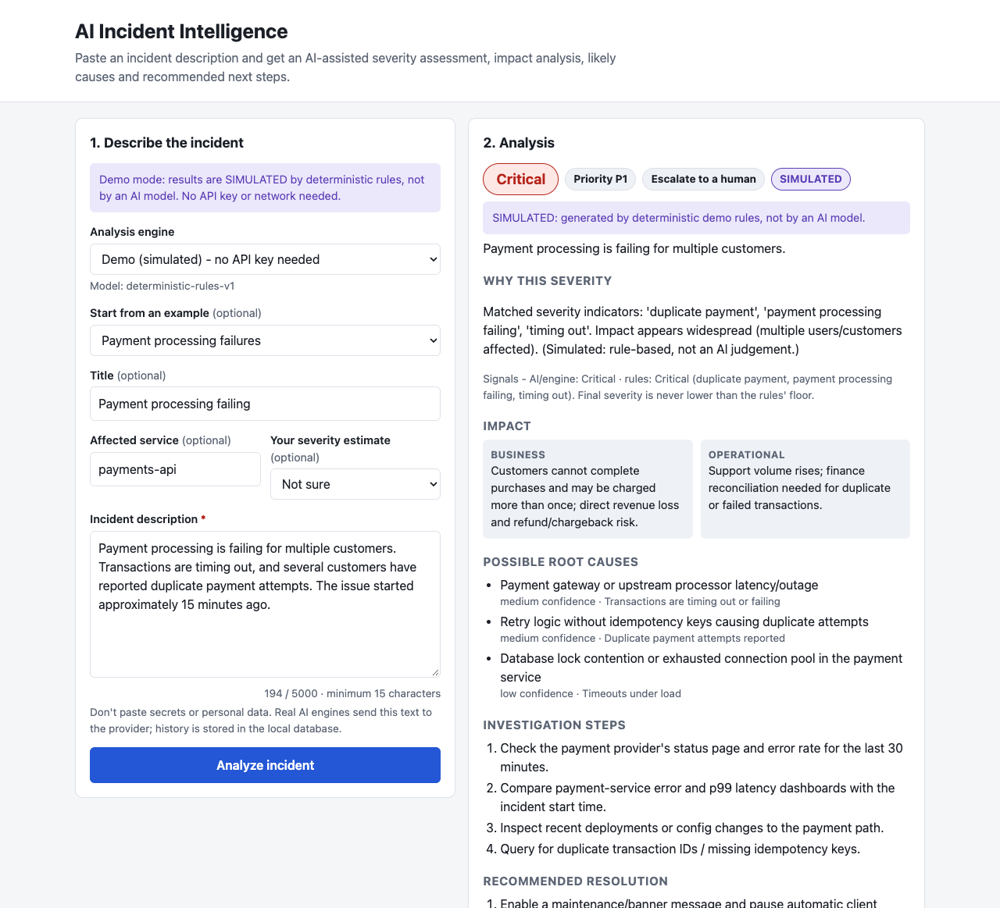
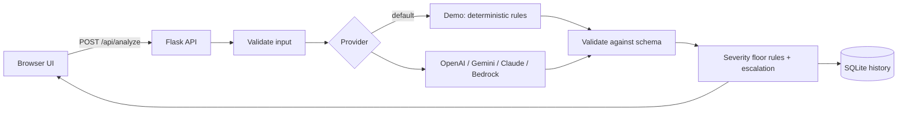

# AI Incident Intelligence

**AI-powered incident analysis and severity assessment, with multi-provider LLM support and a local demo mode.**

Paste an incident description. Get back a severity (Critical / High / Medium / Low), the reasoning, business and operational impact, likely root causes, and recommended investigation and resolution steps.



## Why this exists

It began as an AWS hackathon prototype: a six-step pipeline on Amazon Bedrock that diagnosed an incident, escalated it, emailed stakeholders and wrote a post-mortem. This version keeps the part that was useful, which is **triage**, and makes it runnable by anyone:

- Works **with no API keys** (demo mode, simulated, clearly labelled).
- Works with **OpenAI, Google Gemini, Anthropic Claude or AWS Bedrock**.
- Returns **validated, structured** output instead of free text.

**Problem it solves:** the first minutes of an incident are spent working out how bad it is, who is affected and where to look. This gives on-call engineers a fast, consistent first assessment. It is decision support, not a replacement for judgment.

## Quick start (no API keys needed)

Requires Python 3.9+. Tested on 3.14.

```bash
git clone <this-repo-url> ai-incident-intelligence && cd ai-incident-intelligence
python3 -m venv .venv && source .venv/bin/activate      # Windows: .venv\Scripts\activate
pip install -r requirements.txt
python -m incident_intel
```

Open **http://127.0.0.1:5000**, choose an example from the dropdown and click **Analyze incident**.

## How it works



1. The input is validated (length limits, allowed values).
2. The selected provider returns a JSON analysis. All providers share one interface and one prompt.
3. The JSON is checked against a strict schema. A malformed answer is an error, never silently patched.
4. **Safety rules** from the original project (keyword → severity) act as a **floor**. If the text says "payment failure" and the model said Low, the result is raised to Critical, and the reasoning says so. Rules never lower a model's severity.
5. Priority (P1–P4) and escalation routing are derived from the final severity, and the result is saved to local history.

## Supported providers

| Provider | `provider` id | Needs | Verified |
|---|---|---|---|
| **Demo** (default) | `demo` | nothing | Yes, fully tested |
| OpenAI | `openai` | `OPENAI_API_KEY` | Unit-tested with mocked HTTP only |
| Google Gemini | `gemini` | `GEMINI_API_KEY` | Unit-tested with mocked HTTP only |
| Anthropic Claude | `anthropic` | `ANTHROPIC_API_KEY` | Unit-tested with mocked HTTP only |
| AWS Bedrock | `bedrock` | AWS credentials, `BEDROCK_REGION`, `BEDROCK_MODEL_ID`, `boto3` | Unit-tested with a mocked client only |

> The four real providers have **not been run against the live APIs** (no credentials were available during development). If one fails, you get a specific error (invalid key, rate limit, unknown model, provider down) and never a demo result. Add a provider by subclassing `Provider` in `incident_intel/providers/` and registering it in `providers/__init__.py`.

### Demo mode

Demo mode is the default. It uses deterministic keyword rules and canned templates, so it works offline and gives the same answer for the same input. Every demo response carries a `SIMULATED` badge and a notice. It is **not** an LLM, and it is never used as a fallback for a failed real provider.

### Using a real provider

```bash
cp .env.example .env     # .env is git-ignored
# edit .env: set the key (and model) for ONE provider, e.g.
#   OPENAI_API_KEY=...        OPENAI_MODEL=<a model you can use>
#   DEFAULT_PROVIDER=openai   (optional; otherwise pick it in the UI)
python -m incident_intel
```

Keys are read only by the server and are never returned by the API or logged. The model name is always configurable (`OPENAI_MODEL`, `GEMINI_MODEL`, `ANTHROPIC_MODEL`, `BEDROCK_MODEL_ID`). The defaults are examples, so check they exist for your account.

**Bedrock:** `pip install -r requirements-aws.txt`, configure AWS credentials the usual way (`aws configure`, `AWS_PROFILE` or a role), set `BEDROCK_REGION` and `BEDROCK_MODEL_ID`, and enable model access in the Bedrock console. It uses the model-agnostic Converse API.

## Input and output

**Input** (`POST /api/analyze`): only `description` is required.

```json
{
  "description": "Payment processing is failing for multiple customers. Transactions are timing out, and several customers have reported duplicate payment attempts. The issue started approximately 15 minutes ago.",
  "title": "Payment processing failing",
  "service": "payments-api",
  "reported_severity": "High",
  "provider": "demo"
}
```

**Output** (abridged, from a real demo-mode run):

```json
{
  "ok": true,
  "data": {
    "provider": "demo", "model": "deterministic-rules-v1", "simulated": true,
    "notice": "SIMULATED: generated by deterministic demo rules, not by an AI model.",
    "result": {
      "summary": "Payment processing is failing for multiple customers.",
      "severity": "Critical",
      "suggested_priority": "P1",
      "severity_reasoning": "Matched severity indicators: 'duplicate payment', 'payment processing is failing', 'timing out'. Impact appears widespread ...",
      "impact": { "business": "Customers cannot complete purchases and may be charged more than once ...", "operational": "Support volume rises ..." },
      "possible_root_causes": [{ "cause": "Payment gateway or upstream processor latency/outage", "confidence": "medium", "evidence": "..." }],
      "investigation_steps": ["Check the payment provider's status page ..."],
      "resolution_steps": ["Roll back the most recent payment-service release ..."],
      "next_actions": ["Assign an incident owner ..."],
      "needs_human_escalation": true,
      "confidence": "medium"
    },
    "severity_signals": { "model": "Critical", "rules": "Critical", "reported": "High", "final": "Critical" },
    "escalation": { "should_escalate": true, "route_to": "Incident commander + SME on-call; notify stakeholders" }
  }
}
```

With a real provider, the content is written by the model and `simulated` is `false`.

### API

| Method & path | Purpose |
|---|---|
| `POST /api/analyze` | Analyze an incident |
| `GET /api/providers` | Providers and whether each is configured (never any secrets) |
| `GET /api/samples` | Bundled sample incidents |
| `GET /api/incidents`, `GET /api/incidents/<id>` | History |
| `DELETE /api/incidents/<id>`, `DELETE /api/incidents` | Delete one / all history |
| `GET /api/health` | Health check |

Every response is `{"ok": true, "data": ...}` or `{"ok": false, "error": {"code", "message"}}`. Error codes include `validation_error`, `provider_not_configured`, `invalid_credentials`, `rate_limited`, `model_unavailable`, `provider_unavailable` and `invalid_provider_response`.

## Severity methodology

Final severity is `max(model severity, rule severity)`.

| Rule level | Example phrases |
|---|---|
| Critical | data loss, server down, security breach, payment failing, duplicate payments, unable to log in, "critical" |
| High | timeout / timing out, 504, 5xx, outage, memory leak, deadlock, unavailable |
| Medium | slow, latency, degraded, partial outage, intermittent |
| Low | minor, cosmetic, typo, UI glitch |

Priority: Critical→P1, High→P2, Medium→P3, Low→P4. Escalation is recommended for Critical and High, or when the model asks for a human. Matching is whole-word and case-insensitive. The rules are in `incident_intel/rules.py`. They come from the original project and have **not** been validated against labelled data.

## Persistence

Analyses are stored in a local **SQLite** file (`data/incidents.db`, git-ignored) so the UI can show history. The schema is created by versioned migrations (`incident_intel/migrations/`) when the app starts. No credentials are stored. **Incident text is stored**, so don't submit sensitive data. Set `HISTORY_ENABLED=false` to store nothing. Optional sample data: `python -m incident_intel.seed` (analysed in demo mode).

## Development

```bash
pip install -r requirements-dev.txt     # includes boto3 and pytest
python -m pytest -q                     # no network, no credentials needed
python -m incident_intel                # dev server (FLASK_DEBUG=1 for auto-reload)
```

Production-style run (there is no frontend build step; the UI is plain HTML/CSS/JS; gunicorn is in `requirements.txt`):

```bash
gunicorn -w 2 -b 127.0.0.1:8000 "incident_intel.app:create_app()"
```

```
incident_intel/
  app.py  api.py  analysis.py      Flask factory, routes, orchestration
  config.py  schemas.py  errors.py Settings, validated models, typed errors
  rules.py                         Severity floor rules + escalation/priority maps
  storage.py  migrations/          SQLite + SQL migrations
  providers/                       base, demo, openai, gemini, anthropic, bedrock, registry
  samples.json  seed.py
frontend/                          index.html, app.js, styles.css (no build step)
tests/                             pytest suite
```

## Deployment

Docker, any GitHub-connected hosting site (Procfile included), or a manual Linux server: see **[docs/DEPLOYMENT.md](docs/DEPLOYMENT.md)**. The app has no authentication, so for public hosting use demo mode or add access control.

```bash
docker build -t ai-incident-intelligence . && docker run -p 8000:8000 -v incident-data:/app/data ai-incident-intelligence
```

## Known limitations

- Real-provider adapters are tested with mocks only (see above).
- The demo analyzer is a rule engine. Its text is generic and keyword-driven, not intelligent.
- Severity rules are keyword-based, unvalidated, and English-only.
- There is **no authentication or rate limiting**. Anyone who can reach the server can trigger paid provider calls, so keep it on `127.0.0.1` or put it behind your own auth.
- Incident text is sent to the selected third-party provider, and stored locally in history.
- LLM output can be wrong or incomplete; the schema check guarantees shape, not truth.
- Dropped from the original hackathon pipeline: DynamoDB storage, SES email, the closure stub and the post-mortem agent. They could be added back as optional modules.

## Security and privacy

- API keys are read from environment variables on the server only. They are never returned by the API, written to logs, or placed in URLs. `.env` is git-ignored; commit only `.env.example`.
- Logs record the provider, severity and timing, never incident text or keys. Provider error messages are redacted before display.
- Real providers receive the incident text you submit. Use sanitized descriptions; don't paste customer data, credentials or internal hostnames.
- The sample incidents are synthetic. See [SECURITY.md](SECURITY.md) for reporting issues.

## Troubleshooting

| You see | Likely cause |
|---|---|
| `provider_not_configured` | The key/model for that provider isn't set in the server's environment. Restart after editing `.env`. |
| `invalid_credentials` | Wrong or expired key (or Bedrock IAM permissions missing). |
| `model_unavailable` | The configured model name doesn't exist or isn't enabled for your account/region. Change `*_MODEL`. |
| `rate_limited` / `provider_unavailable` | Provider quota or outage. Retry later. |
| `invalid_provider_response` | The model didn't return valid JSON in the expected shape. Retry or try another model. |
| A provider is greyed out in the UI | It isn't configured; hover for the hint. |

## License

[MIT](LICENSE).
